# Node

- [Node.js 설치와 확인](#nodejs-설치와-확인)
- [package.json과 패키지 설치](#packagejson과-패키지-설치)
- [lodash](#lodash)
- [npm scripts](#npm-scripts)
- [nodemon](#nodemon)
- [Parcel](#parcel)
- [Parcel 번들러와 import](#parcel-번들러와-import)
- [.gitignore](#gitignore)
- [GitHub에 올리기](#github에-올리기)
- [gh-pages 배포](#gh-pages-배포)

<br>

---

### Node.js 설치와 확인

> Node.js는 브라우저 밖에서 JavaScript를 실행하는 환경이다. 지금까지 JavaScript는 브라우저에서만 실행했지만, Node.js를 설치하면 터미널에서 JS 파일을 직접 실행하고, 서버나 개발 도구를 JS로 만들 수 있다. 공식 사이트에서 LTS 버전을 설치한 뒤 `node -v`로 버전이 나오는지 확인한다.

<br>

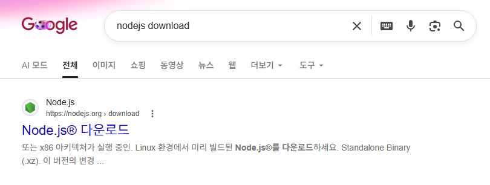

<br>

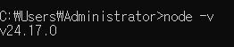

<br>

| **용어** | **설명** |
| --- | --- |
| Node.js | 브라우저 밖에서 JS를 실행하는 실행 환경(런타임). 크롬의 JS 엔진(V8)을 사용 |
| npm | Node Package Manager. Node.js를 설치하면 함께 설치되는 패키지 관리자. 남이 만든 라이브러리(패키지)를 설치하고 관리 |
| 패키지 | 재사용할 수 있도록 묶어 배포한 코드(라이브러리, 도구). 예: lodash, nodemon, parcel |

<br>

<span style="color:brown">PowerShell에서 `npm` 실행이 보안 정책으로 막히면 관리자 권한으로 PowerShell을 열고 `Set-ExecutionPolicy -Scope CurrentUser -ExecutionPolicy RemoteSigned`를 입력한다. 현재 사용자에 한해 직접 만든 스크립트와 서명된 스크립트의 실행을 허용하는 설정이다.</span>

<br>

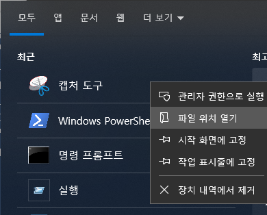

<br>

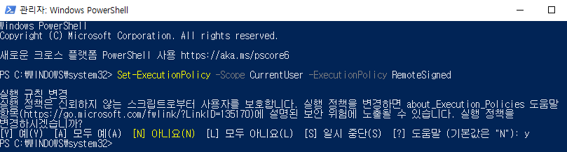

<br>

`npm help`로 npm 명령어 목록과 사용법을 확인한다.

<br>

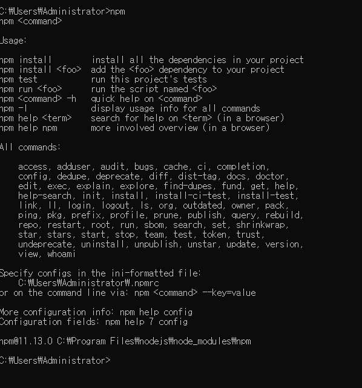

---

### package.json과 패키지 설치

> `package.json`은 프로젝트의 이름, 버전, 사용하는 패키지, 실행 명령(`scripts`)을 적어 두는 설정 파일이다. 폴더를 만들고 VSCode로 열어 터미널에서 `npm init -y`를 입력하면 만들어진다. `-y`는 질문에 모두 기본값으로 답한다는 뜻이다.

<br>

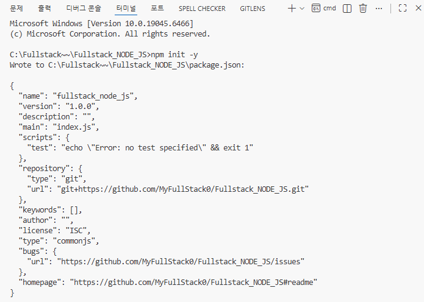

<br>

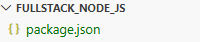

<br>

**주요 명령**

| **명령** | **설명** |
| --- | --- |
| `npm init -y` | 질문 없이 기본값으로 `package.json` 생성 |
| `npm install 패키지` | 패키지 설치. `node_modules/` 폴더와 `package-lock.json`이 자동 생성되고 `package.json`의 `dependencies`에 기록 |
| `npm install` | `package.json`에 적힌 패키지를 모두 다시 설치. `node_modules/`를 지워도 이 명령으로 복구할 수 있다 |
| `npm install 패키지 -D` | 개발할 때만 필요한 패키지로 설치(`devDependencies`에 기록). `--save-dev`와 같다 |
| `node 파일명` | JS 파일 실행 |
| `npm run 이름` | `scripts`에 등록한 명령 실행 |

<br>

**생성 파일**

| **이름** | **설명** |
| --- | --- |
| `node_modules/` | 설치한 패키지가 저장되는 폴더. 용량이 크고 `npm install`로 복구되므로 git에 올리지 않는다 |
| `package-lock.json` | 설치된 패키지의 정확한 버전을 기록한 파일. 다른 환경에서도 같은 버전이 설치되도록 한다 |
| `dependencies` | 프로그램이 실행될 때도 필요한 패키지. 예: lodash |
| `devDependencies` | 개발할 때만 필요한 패키지. 예: parcel, nodemon, gh-pages |

<br>

- 예제 코드: [npm 실습](../01_Npm/package.json)

---

### lodash

> 배열, 객체, 함수를 다루는 유틸리티 함수를 모아 둔 대표적인 JavaScript 라이브러리다. `npm install lodash`로 설치하고, `require("lodash")`로 불러와 관례대로 `_`에 담아 사용한다. `require`는 Node.js의 기본 모듈 방식(CommonJS)이다.

<br>

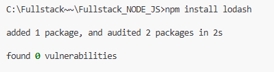

<br>

| **함수** | **설명** |
| --- | --- |
| `_.shuffle(배열)` | 배열의 순서를 무작위로 섞은 새 배열 반환 |
| `_.join(배열, 구분자)` | 배열 요소를 구분자로 이어 붙인 문자열 반환 |

<br>

`index.js`를 만들어 `_.shuffle()`로 배열을 섞고, 터미널에서 `node index.js`로 실행한다. 실행할 때마다 순서가 달라진다.

<br>

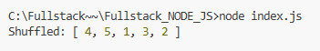

<br>

- 예제 코드: [lodash로 배열 섞기](../01_Npm/index.js)

---

### npm scripts

> `package.json`의 `scripts`에 명령을 이름으로 등록해 두면 `npm run 이름`으로 실행한다. 긴 명령을 외우지 않아도 되고 팀원이 같은 명령으로 실행할 수 있다. `start`는 특별한 이름이라 `run`을 생략하고 `npm start`로도 실행한다.

<br>

```json
"scripts": {
    "start": "node index.js",
    "start2": "parcel index.html",
    "build": "parcel build index.html"
}
```

<br>

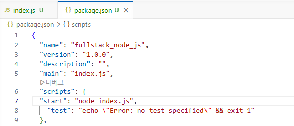

<br>

`npm run start`를 입력하면 등록한 `node index.js`가 실행된다.

<br>

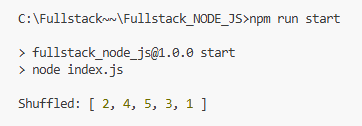

---

### nodemon

> 파일을 저장하면 프로그램을 자동으로 다시 실행해 주는 도구다. 서버를 개발할 때 코드를 수정할 때마다 서버를 껐다 켜야 하는 번거로움이 없어진다. `npm install nodemon`으로 설치하고, `node` 대신 `nodemon 파일명`으로 실행한다.

<br>

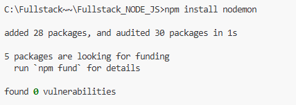

---

### Parcel

> HTML, JS, CSS 파일을 하나로 묶어(번들링) 실행해 주는 도구(번들러)다. 설정 없이 `html` 파일만 지정하면 개발 서버를 띄우고, 코드를 바꾸면 화면에 자동으로 반영한다. 개발할 때만 쓰므로 `-D`로 설치한다.

<br>

| **명령** | **설명** |
| --- | --- |
| `npm install --save-dev parcel` | Parcel 설치 |
| `npm run start2` | `parcel index.html`. 개발 서버 실행. 주소는 `localhost:1234` |
| `npm run build` | `parcel build index.html`. 배포용으로 최적화한 파일을 `dist/` 폴더에 생성 |

<br>

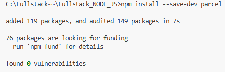

<br>

`npm run start2`로 개발 서버를 실행한다.

<br>

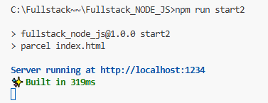

<br>

<span style="color:brown">`package.json`의 `main`에 적힌 파일(`index.js`)이나 지정한 html 파일이 없으면 `Entry ... does not exist` 오류가 난다. 파일이 있는지, `main` 값이 맞는지 확인한다.</span>

<br>

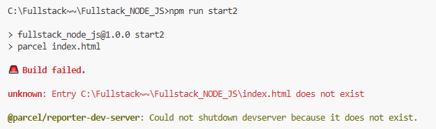

<br>

`npm run build`를 실행하면 `dist/` 폴더에 결과물이 만들어진다.

<br>

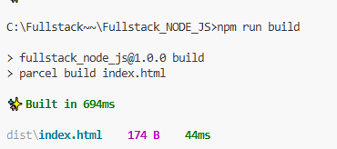

---

### Parcel 번들러와 import

> `parcel-bundler`(1.x)는 html에 연결한 JS에서 `import`로 패키지를 불러오면 번들링해서 브라우저에서 사용할 수 있게 한다. 브라우저는 `node_modules`의 패키지를 직접 불러올 수 없기 때문에 번들러가 필요하다. `npm install parcel-bundler -D`로 설치하고 `npx parcel index.html`로 실행한다. `npx`는 설치한 패키지의 실행 파일을 바로 실행하는 명령이다.

<br>

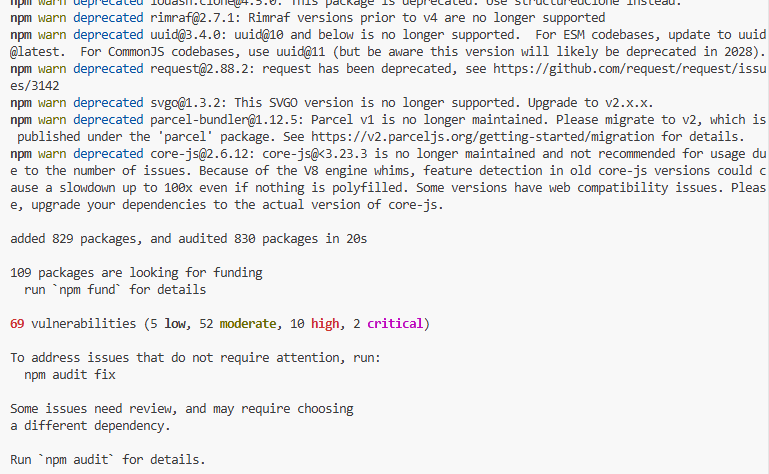

<br>

`index.html`에서 `index.js`를 `<script src="./index.js">`로 연결하고 실행하면 `localhost:1234`에서 확인한다.

<br>

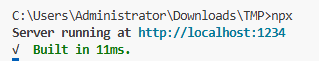

<br>

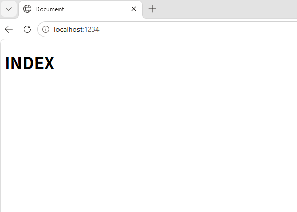

<br>

서버가 실행 중인 터미널은 그대로 두고 새 터미널을 열어 `npm install lodash`를 설치한다. `index.js`에서 `import _ from 'lodash'`로 불러와 사용하면 브라우저 콘솔에 결과가 출력된다.

<br>

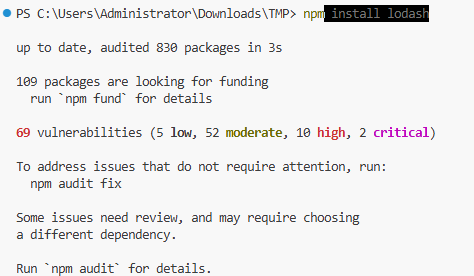

<br>

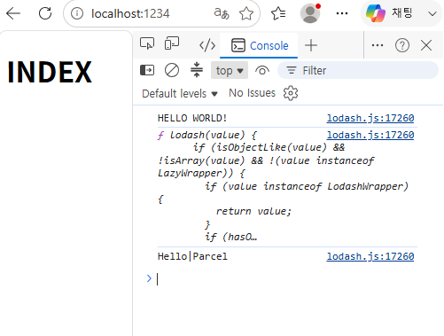

<br>

| **구분** | **설명** |
| --- | --- |
| `require("lodash")` | Node.js에서 쓰는 CommonJS 방식 |
| `import _ from 'lodash'` | 브라우저와 번들러에서 쓰는 ES 모듈 방식 |

<br>

- 예제 코드: [Parcel과 lodash](../02_ParcelBundler/index.js)
- 예제 코드: [Parcel 실행 페이지](../02_ParcelBundler/index.html)

---

### .gitignore

> git에 올리지 않을 파일과 폴더를 적는 파일이다. `node_modules/`는 용량이 크고 `npm install`로 언제든 복구되므로 올리지 않는다. `dist/`, `.parcel-cache/`처럼 빌드로 만들어지는 폴더도 제외한다. [gitignore.io](https://www.toptal.com/developers/gitignore/)에서 `Node`를 선택해 생성하면 Node 프로젝트에 필요한 내용을 만들어 준다.

<br>

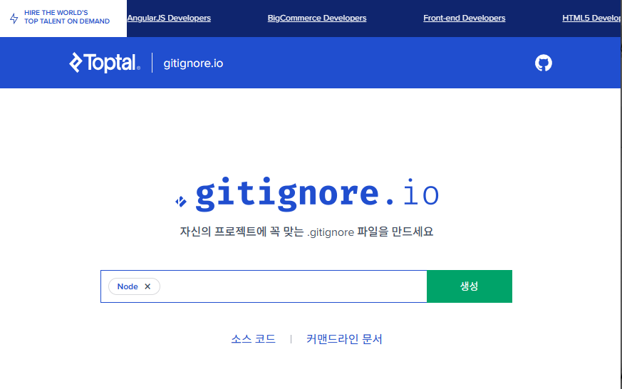

<br>

생성된 내용을 복사해 프로젝트의 `.gitignore` 파일에 붙여 넣는다.

<br>

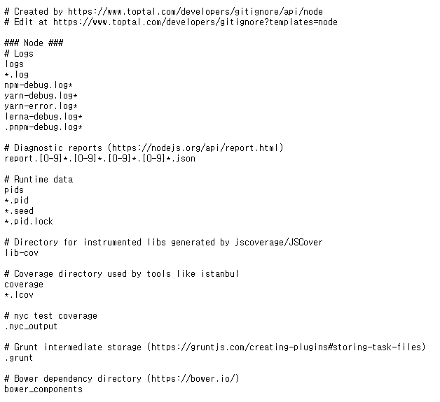

<br>

- 예제 코드: [.gitignore](../02_ParcelBundler/.gitignore)

---

### GitHub에 올리기

> README가 없는 빈 저장소를 GitHub에 만들고, 로컬 폴더를 저장소로 초기화해 연결한 뒤 올린다.

<br>

```bash
git init
git add *
git commit -m "세팅"
git remote add origin <저장소 주소>
git remote -v            # 연결 확인
git branch -M main
git push --set-upstream origin main
```

<br>

| **명령** | **설명** |
| --- | --- |
| `git init` | 현재 폴더를 git 저장소로 초기화 |
| `git add *` | 변경된 파일을 스테이징 |
| `git commit -m "메시지"` | 커밋 생성 |
| `git remote add origin 주소` | 원격 저장소 `origin` 연결. `git remote -v`로 확인 |
| `git branch -M main` | 브랜치 이름을 `main`으로 변경 |
| `git push --set-upstream origin main` | `main`을 `origin`에 올리고 이후 `git push`만으로 올리도록 연결 |

---

### gh-pages 배포

> `gh-pages` 패키지는 빌드한 `dist/` 폴더를 GitHub Pages용 `gh-pages` 브랜치에 올려 웹으로 배포한다. `npm install gh-pages -D`로 설치하고, `package.json`의 `scripts`에 빌드와 배포 명령을 추가한다. `npm run build`로 `dist/`를 만든 뒤 `npm run deploy`로 올린다.

<br>

```json
"build": "npx parcel build index.html",
"deploy": "gh-pages -d dist"
```

<br>

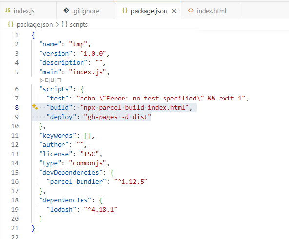

<br>

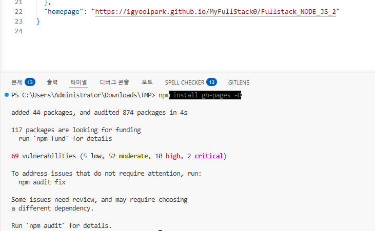

<br>

---

<br>

**Node 요약**

<aside>

> Node.js: 브라우저 밖에서 JS 실행, npm: 패키지 관리자 <br>
package.json: 프로젝트 정보, 패키지, scripts / npm install로 복구 / -D는 개발용(devDependencies) <br>
lodash: 유틸리티 라이브러리, nodemon: 저장하면 자동 재시작, Parcel: HTML, JS, CSS 번들러 <br>
.gitignore: node_modules, dist 제외, gh-pages: dist를 GitHub Pages로 배포

</aside>

<br>

### Link
[Node.js](https://nodejs.org/ko) <br>
[npm 문서](https://docs.npmjs.com/) <br>
[Parcel](https://parceljs.org/)
